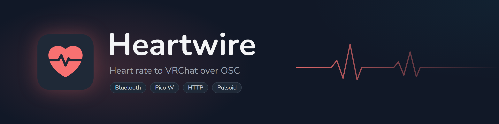

<p align="center">
  
</p>

<p align="center">
  <a href="https://github.com/RealWhyKnot/heartwire/actions/workflows/ci.yml"></a>
  <a href="https://github.com/RealWhyKnot/heartwire/releases/latest"></a>
  <a href="https://github.com/RealWhyKnot/heartwire/releases"></a>
  
  <a href="LICENSE"></a>
</p>

<p align="center">
  <a href="https://github.com/RealWhyKnot/heartwire/releases/latest">Download</a> ·
  <a href="https://github.com/RealWhyKnot/heartwire/issues/new?template=bug_report.yml">Report a bug</a> ·
  <a href="https://github.com/RealWhyKnot/heartwire/releases">Changelog</a> ·
  <a href=".github/SECURITY.md">Security</a>
</p>

Heartwire sends your heart rate to VRChat over OSC. It reads a Bluetooth chest strap or watch directly, a Raspberry Pi Pico W over USB, HTTP posts from another app, or a Pulsoid widget.

Heavily inspired by [hr-osc](https://github.com/kamyu1537/hr-osc) by kamyu. Heartwire is written from scratch, but the window, the settings and the OSC parameter names match hr-osc's, so avatars built for hr-osc work unchanged.

## Install

On Windows, run `heartwire-<version>-win-x64-setup.exe` from the [latest release](https://github.com/RealWhyKnot/heartwire/releases/latest). It installs for your account only and doesn't need admin rights. For a portable copy, or on Linux and macOS, unpack the archive for your system and run `heartwire.exe` (or `heartwire`).

The app offers to update itself when a new release is out. Stable builds only move to stable releases, and betas take whichever is newest. You can turn the check off under Settings > General.

If hr-osc has been used on this computer, Heartwire offers to import its settings the first time it starts. Close hr-osc first, since both want port 8080 in HTTP mode.

Settings and the log live in `%APPDATA%\heartwire` on Windows, `~/.config/heartwire` on Linux and `~/Library/Application Support/heartwire` on macOS.

## Heart rate sources

Pick one under Settings > General > Service Type. The Home tab shows the reading and which device it came from, and the taskbar icon beats along with it.

| Service | Reads from |
|---|---|
| Auto (default) | The Pico if one is plugged in, otherwise the computer's Bluetooth |
| Bluetooth | Any strap or watch broadcasting the standard heart rate service (`0x180D`) |
| Pico (USB) | A Pico W or Pico 2 W running the firmware in `firmware/` |
| HTTP | A POST holding a bare number, sent to port 8080 |
| Pulsoid / Stromno | A Pulsoid widget ID |

### Bluetooth

Settings > Bluetooth lists every heart rate device in range. "Any heart rate device" takes the strongest one, or you can pick one. A strap only takes one connection at a time, so it won't show up while a phone or a Pico is connected to it.

### Pico W

For computers without Bluetooth, a Pico W reads the strap and passes readings over USB.

1. Hold BOOTSEL while you plug the board in, then copy the MicroPython `.uf2` for your board ([Pico 2 W](https://micropython.org/download/RPI_PICO2_W/) or [Pico W](https://micropython.org/download/RPI_PICO_W/)) to the `RPI-RP2` drive.
2. Click Install Firmware under Settings > Pico. If more than one strap is nearby, type part of its name in Strap Name first.
3. Put the strap on. The board's LED lights up when it connects.

On Linux, your account needs serial port access: `sudo usermod -a -G dialout $USER`, then log out and back in.

### HTTP

```bash
curl -X POST -d '60' http://localhost:8080
```

The server listens on every network interface, so a phone app on the same network can post to your computer.

## VRChat parameters

| Parameter | Type | Value |
|---|---|---|
| `hr_connected` | Bool | True while readings arrive, false after Connected Timeout seconds without one |
| `hr_percent` | Float | Heart rate divided by Max Heart Rate, from 0 to 1 |

You can rename both under Settings > Parameters. OSC goes to `127.0.0.1:9000` by default.

## SteamVR and start-up

Both options are under Settings > General. "Start with SteamVR" (Windows) launches Heartwire with SteamVR and adds a heart icon to the dashboard that shows your heart rate and its source. A copy SteamVR started closes with it. "Start at login" opens the app minimized when you sign in.

## Building

```bash
cargo build --release
```

[CONTRIBUTING.md](CONTRIBUTING.md) lists the Linux packages you need, the checks CI runs and how releases are tagged.

## License

GPL-3.0. The font and icon licences are in [NOTICE.md](NOTICE.md).
